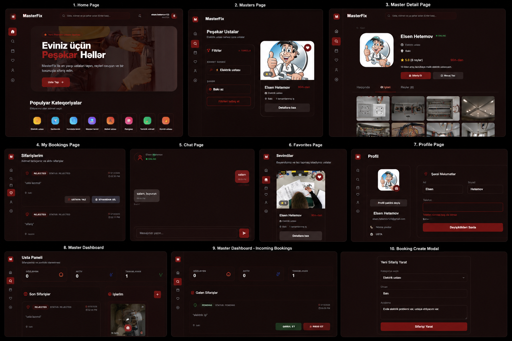
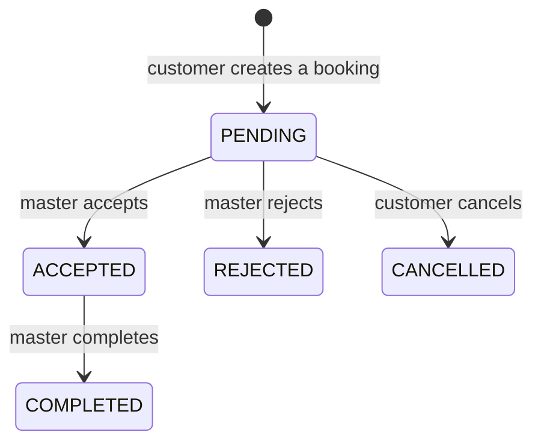
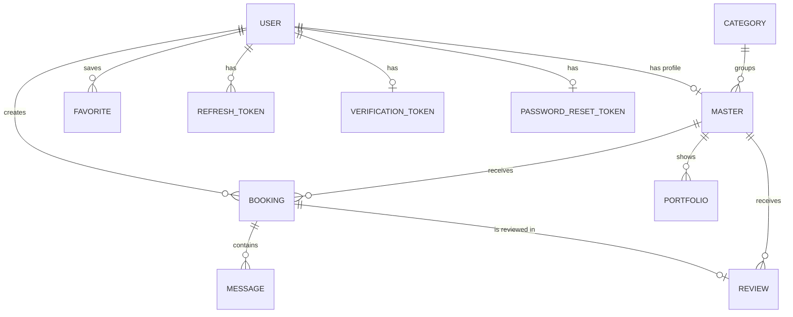

<p align="center">
  
</p>

# MasterFix — Service Marketplace

MasterFix connects customers with local craftsmen ("masters"): electricians, plumbers, AC technicians, furniture and computer repair and more.
Customers find a master, book a job, chat about it and leave a review. Masters manage their profile, portfolio and incoming bookings.

**Backend:** Java 21 · Spring Boot 4 · Spring Security · JWT · Spring Data JPA · PostgreSQL · Java Mail · Swagger / OpenAPI · Docker Compose
**Frontend:** React · Vite · Tailwind CSS (in [`/frontend`](frontend))



## Features

**Authentication and security**
- Registration and login with JWT access tokens
- Refresh tokens stored in the database, with token rotation
- Email verification and forgot / reset password flow (token-based, sent with Java Mail)
- Role-based access for `USER`, `MASTER` and `ADMIN` with `@PreAuthorize`
- Passwords hashed with BCrypt, stateless sessions

**Bookings**
- Customers create, cancel and remove bookings
- Masters accept, reject and complete bookings
- Messages between customer and master inside each booking

**Masters**
- Master profile, profile image and portfolio uploads (with file size validation)
- Search, filter by category and city, pagination and sorting

**Reviews and favorites**
- Reviews and star ratings with average rating per master
- Favorite masters list

**Admin**
- Default admin account created on startup from environment variables
- Activate / deactivate users, remove reviews, manage categories

## Booking workflow



## Architecture

Layered architecture: **Controller → Service → Repository → PostgreSQL**

- Request and response DTOs, entities are not returned from the API
- Global error handling with `@RestControllerAdvice` and custom exceptions
- JWT filter in the Spring Security filter chain
- Configuration (JWT secret, mail credentials) comes from environment variables

## Data model



## API overview

Full documentation: **Swagger UI** at `http://localhost:8080/swagger-ui/index.html`

| Area | Endpoints |
|---|---|
| Auth | `POST /auth/register` · `POST /auth/login` · `POST /auth/refresh` · `GET /auth/verify` · `POST /auth/forgot-password` · `POST /auth/reset-password` |
| Masters | `GET /masters` · `GET /masters/{id}` · `GET /masters/search` · `GET /masters/city` · `GET /masters/category/{categoryId}` · `PUT /masters/me` · `POST /masters/me/profile-image` · `POST /masters/me/portfolio` |
| Bookings | `POST /bookings` · `GET /bookings/my` · `PUT /bookings/{id}/cancel` · `GET /bookings/master` · `PUT /bookings/{id}/accept` · `PUT /bookings/{id}/reject` · `PUT /bookings/{id}/complete` |
| Messages | `GET /bookings/{id}/messages` · `POST /bookings/{id}/messages` |
| Reviews | `POST /reviews` · `GET /reviews/master/{masterId}` · `GET /reviews/my` |
| Favorites | `POST /favorites/{masterId}` · `DELETE /favorites/{masterId}` · `GET /favorites/my` |
| Admin | `GET /users` · `PUT /users/{id}/toggle-status` · `DELETE /reviews/admin/{id}` · `POST /categories` · `PUT /categories/{id}` · `DELETE /categories/{id}` |

## Tests and CI

- Unit tests for the booking workflow with JUnit 5 and Mockito (`BookingServiceTest`)
- GitHub Actions runs `./gradlew build` with PostgreSQL 16 on every push and pull request

## Getting started

**Requirements:** JDK 21, Docker, Node.js (for the frontend)

```bash
git clone https://github.com/MehribanNusretova/MasterFixApplication.git
cd MasterFixApplication
```

**1. Environment variables**

| Variable | Description |
|---|---|
| `JWT_SECRET_KEY` | Random secret, at least 32 characters |
| `MAIL_USERNAME` | Gmail address used to send emails |
| `MAIL_PASSWORD` | Gmail app password |
| `JWT_EXPIRATION_MS` | Optional, access token lifetime (default 15 min) |
| `JWT_REFRESH_EXPIRATION_MS` | Optional, refresh token lifetime (default 7 days) |
| `ADMIN_EMAIL` | Email of the default admin account created on startup |
| `ADMIN_PASSWORD` | Password of the default admin account |
| `ADMIN_PHONE` | Optional, phone of the default admin account |

**2. Backend**

```bash
./gradlew bootRun
```

PostgreSQL starts from `compose.yaml` automatically (Spring Boot Docker Compose support). You can also start it yourself with `docker compose up -d`.
The API runs on `http://localhost:8080`.

**3. Frontend**

```bash
cd frontend
npm install
npm run dev
```

## Project structure

```text
src/main/java/com/example/masterfix
├── config        # security, JWT, Swagger, web config, data initializers
├── controller    # REST controllers
├── dto           # request / response DTOs
├── entity        # JPA entities
├── enums         # booking status, roles
├── exception     # custom exceptions and global handler
├── repository    # Spring Data JPA repositories
├── security      # JWT filter, JWT service, user details service
└── service       # business logic
frontend/         # React + Vite client
screenshots/
```

## What I practiced in this project

- Building a full authentication flow with Spring Security, JWT and refresh tokens
- Modeling a booking workflow with clear status transitions
- Token-based email flows (account verification, password reset)
- File uploads with validation
- Working with feature branches and pull requests

## Roadmap

- More tests: controller tests and integration tests with Testcontainers
- Real-time chat with WebSocket
- Deployment

## Author

**Mehriban Nüsrətova** — Junior Java Backend Developer
[LinkedIn](https://www.linkedin.com/in/mehriban-nusratova) · [GitHub](https://github.com/MehribanNusretova)
